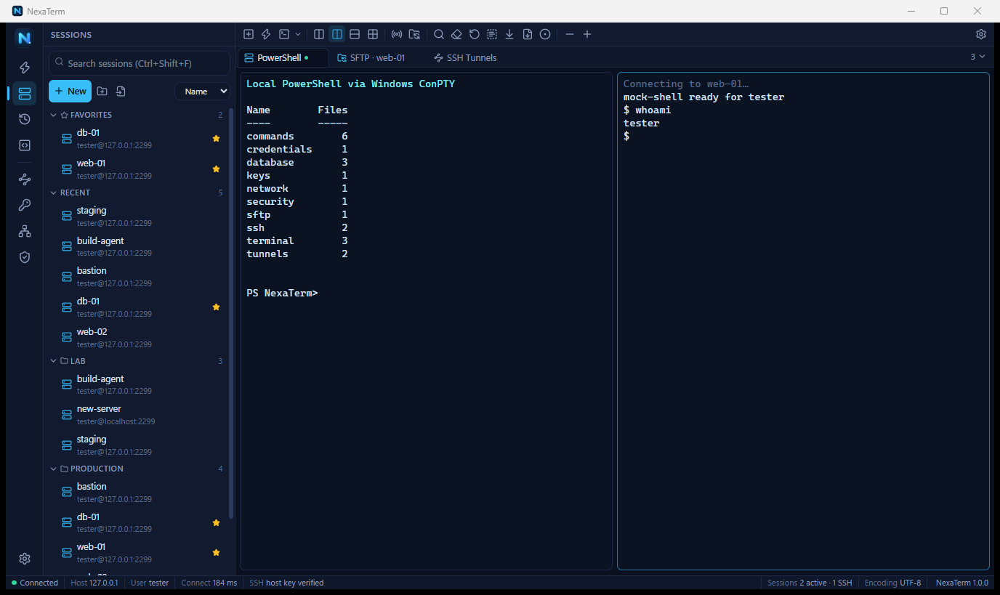
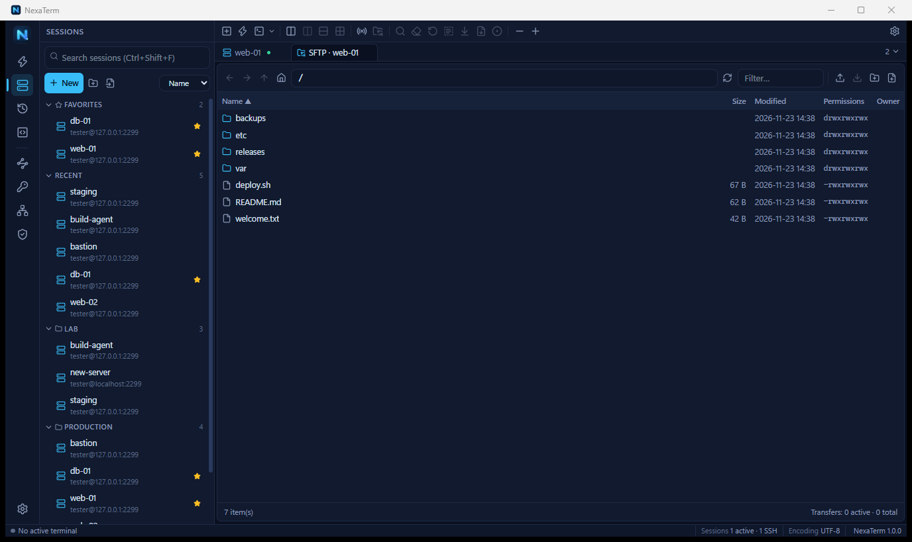
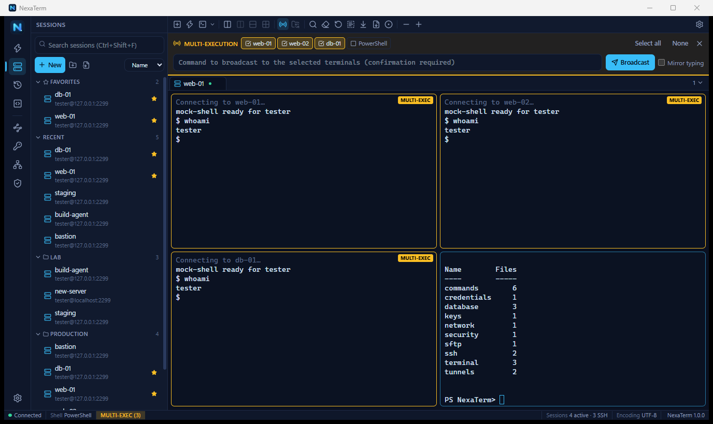
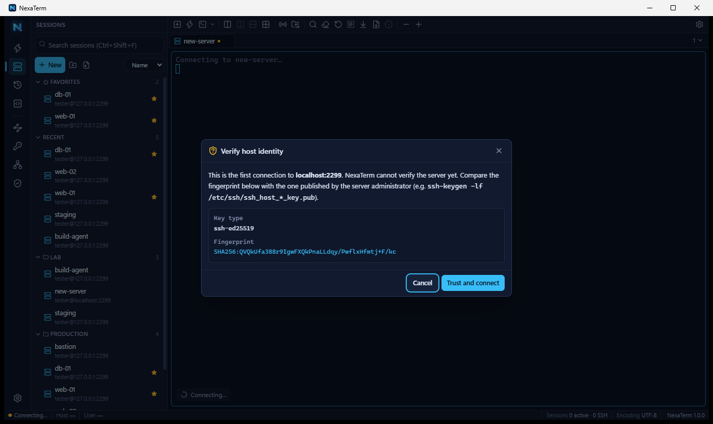
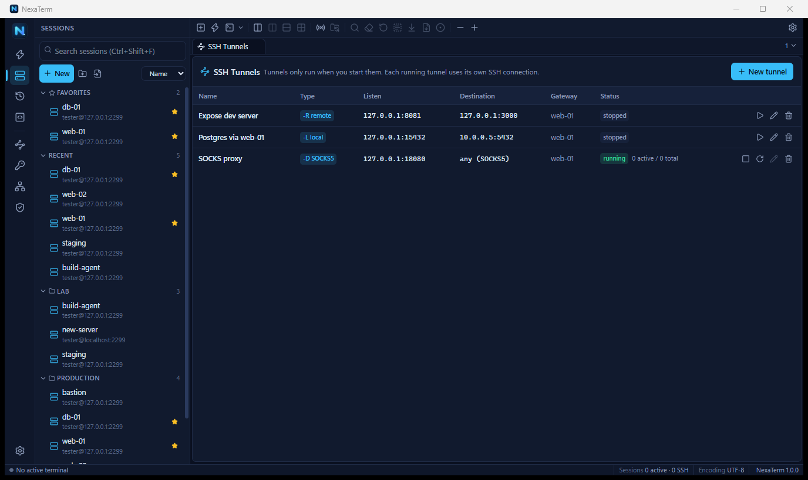
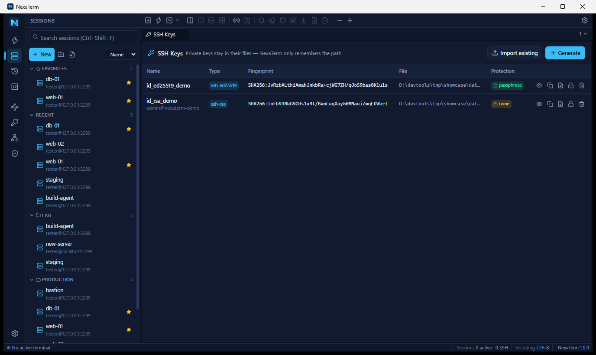
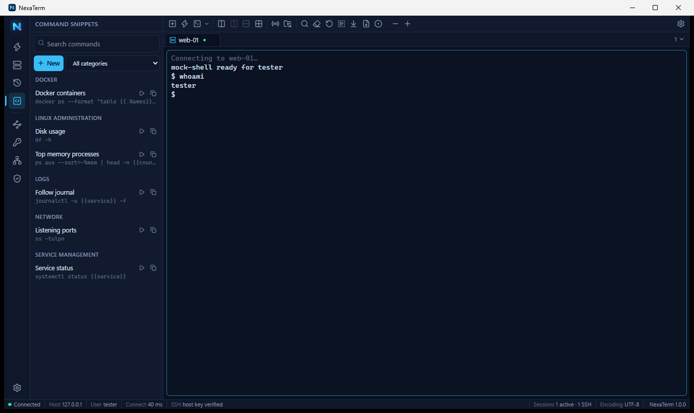
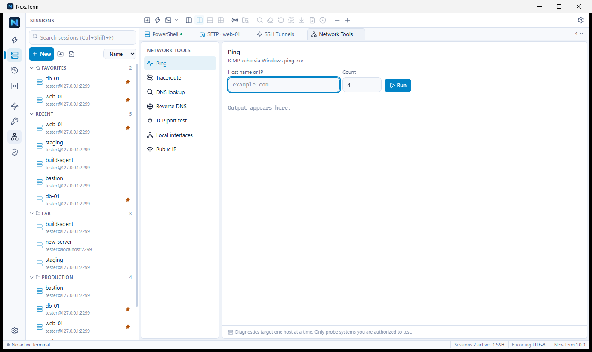

<p align="center">
  
  
</p>

<p align="center"><strong>One Workspace. Every Remote Connection.</strong></p>

<p align="center">
  <a href="https://github.com/bom-sudo/NexaTerm/releases/latest"><b>Download</b></a> &nbsp;|&nbsp;
  <a href="docs/USER_GUIDE.md">User guide</a> &nbsp;|&nbsp;
  <a href="docs/INSTALL.md">Installation</a> &nbsp;|&nbsp;
  <a href="docs/DEVELOPER.md">Build from source</a> &nbsp;|&nbsp;
  <a href="SECURITY.md">Security</a>
</p>

<p align="center">
  <a href="https://github.com/bom-sudo/NexaTerm/actions/workflows/ci.yml"></a>
  
  
  
  
</p>

NexaTerm is a free, open-source (MIT) remote administration workstation for Windows 10/11:
a tabbed terminal with split panes, an SSH client with real host-key verification, an SFTP file
manager, SSH tunnels, multi-execution, an SSH key manager, command snippets and network diagnostics,
in one offline-first desktop app. No account, no telemetry, no paid tier, no usage limits.



## Screenshots

All screenshots show the real application. SSH and SFTP views are connected to the small test
server that ships with the source (`cargo run --example mock_sshd`), which is why hosts read `127.0.0.1`.

<table>
  <tr>
    <td width="50%"><br><b>SFTP file manager</b><br>Browse, upload by drag and drop, download, rename, delete and edit remote files, with a transfer queue.</td>
    <td width="50%"><br><b>Multi-execution</b><br>Send one command to several servers, with a confirmation that lists every target and warns about destructive commands.</td>
  </tr>
  <tr>
    <td><br><b>Host key verification</b><br>Every new server shows its SHA-256 fingerprint first. Changed keys are blocked until you decide.</td>
    <td><br><b>SSH tunnels</b><br>Local (-L), remote (-R) and SOCKS5 (-D) forwards with live status and port-conflict detection.</td>
  </tr>
  <tr>
    <td><br><b>SSH key manager</b><br>Generate Ed25519 or RSA keys, import existing ones, export public keys and change passphrases.</td>
    <td><br><b>Command snippets</b><br>Reusable commands with <code>{{variables}}</code>, shown in full before anything is sent.</td>
  </tr>
  <tr>
    <td colspan="2" align="center"><br><b>Network toolbox, light theme</b><br>Ping, traceroute, DNS, reverse DNS, TCP port test, interfaces and public IP (only on request).</td>
  </tr>
</table>

## Features (v1.0.0)

| Area | What works today |
|---|---|
| Terminal | xterm.js, tabs, split view (2 side-by-side / stacked, 4-pane grid) with draggable dividers, 256-color + truecolor, Unicode 11, search, copy/paste (Ctrl+C with selection, Ctrl+V, Ctrl+Shift+C/V, right-click), clear/reset/select-all/scroll-to-bottom, export output, session logging to file, font/cursor/theme settings, 4 color themes |
| Local shells | Auto-detects Windows PowerShell, PowerShell 7, Command Prompt, Git Bash and WSL distributions; ConPTY backend; custom executables with structured arguments |
| SSH | Password, private key (OpenSSH/PEM, encrypted keys), Windows OpenSSH agent, keyboard-interactive (password-style prompts); SHA-256 host key verification with known-hosts store; ProxyJump via another saved session; keepalive, timeout, retries; startup directory/command; reconnect; many simultaneous sessions |
| Sessions | Create/edit/duplicate/delete, folders (rename/delete, drag-and-drop), favorites, tags, search, sort, recent connections, history, import `~/.ssh/config`, JSON import/export (no secrets), Quick Connect |
| SFTP | Browse with back/forward/up/home, path bar, sort, filter, size/date/permissions/owner, upload (dialog or drag & drop from Explorer), download, sequential transfer queue with progress and cancel, mkdir/new file/rename/delete with confirmations, remote text editor with atomic save |
| Tunnels | Local (-L), remote (-R) and dynamic SOCKS5 (-D) forwards; start/stop/restart/edit/delete; live connection counters; port-conflict detection |
| Multi-execution | Pick target terminals, broadcast a command (with confirmation and destructive-command warnings) or mirror keystrokes; per-target result |
| SSH keys | Generate Ed25519 / RSA (with passphrase), import, view/copy/export public key, change/remove passphrase, malformed-file detection |
| Snippets | Categories, search, `{{variable:default}}` prompts, preview-before-run, copy |
| Network tools | Ping, traceroute, DNS, reverse DNS, TCP port test, local interfaces/hostname, public IP (on click only) — all cancellable |
| Data | SQLite with migrations, backup/restore, Windows Credential Manager for secrets, portable mode |

Also: Telnet and Serial (COM) sessions, X11 forwarding to a local X server, 2FA logins, agent
forwarding, SFTP folder transfer and permissions, an SFTP side panel, MobaXterm/PuTTY import,
output highlighting and macros (see CHANGELOG, Unreleased). Not yet implemented: RDP, VNC,
an embedded X server, master password and remote monitoring. See [DEVELOPMENT_STATUS.md](DEVELOPMENT_STATUS.md).

## Install (v1.0.0)

| Download | Notes |
|---|---|
| `NexaTerm-Setup-x64.exe` (≈287 MB) | Wizard, per-user, no admin. Bundles the WebView2 Runtime → works offline. Needs ~300 MB free in `%TEMP%` while installing. |
| `NexaTerm-Setup-x64-web.exe` (≈3 MB) | Same installer; downloads WebView2 from Microsoft only if missing. |
| `NexaTerm-Portable-x64.zip` (≈3.6 MB) | Extract anywhere, run `NexaTerm.exe`; data stays in `portable-data\`. |

The 1.0.0 files are **not code-signed** (Windows shows "Unknown publisher"); verify downloads
with `SHA256SUMS.txt`. Signed releases come from the Release workflow once SignPath signing is
active, see [Code signing policy](#code-signing-policy).
See [docs/INSTALL.md](docs/INSTALL.md) and the guides shipped with each release.

### Linux (preview, built by CI)

`.deb` (Debian/Ubuntu), `.rpm` (Fedora/openSUSE) and `.AppImage` builds for x64 are produced by
GitHub Actions on every push (artifacts of the [CI workflow](https://github.com/bom-sudo/NexaTerm/actions/workflows/ci.yml))
and attached to tagged releases. On Linux, NexaTerm uses your login shell (bash/zsh/fish) through
a PTY, stores passwords in the desktop keyring (GNOME Keyring / KWallet through the Secret
Service), uses `ssh-agent` via `SSH_AUTH_SOCK`, opens serial devices such as `/dev/ttyUSB0`
(your user must be in the `dialout` group) and forwards X11 to your current `$DISPLAY`.

## Build from source

Prerequisites: Node.js 22+, Rust stable, and a C toolchain (MSVC Build Tools, or the no-admin MinGW
setup in [docs/DEVELOPER.md](docs/DEVELOPER.md)). On Linux (Ubuntu 22.04+):
`sudo apt install build-essential libwebkit2gtk-4.1-dev libgtk-3-dev librsvg2-dev patchelf rpm`,
then `npx tauri build` produces deb/rpm/AppImage in `src-tauri/target/release/bundle/`.

```powershell
git clone <your-repo-url> NexaTerm
cd NexaTerm
npm ci                            # install exact dependency versions
npm run tauri dev                 # run in development mode
npm test                          # frontend unit tests (Vitest)
npm run test:rust                 # Rust unit + SSH/SFTP integration tests
npm run build:release             # full pipeline -> dist/release/v<version>/ (installers, portable zip, checksums)
npm run verify:release            # re-verify a release folder, incl. self-test of the portable exe
```

A local SSH/SFTP test server (login `tester` / `secret`) for trying the app without a real server:
`cargo run --manifest-path src-tauri/Cargo.toml --example mock_sshd -- 2222`

## Repository layout

```
src/                 React + TypeScript UI (features/, layouts/, store/, services/api.ts)
src-tauri/           Rust core (ssh/, sftp/, terminal/, tunnels/, database/, credentials/ …), migrations, tests
packaging/           installer hooks and release documents (templated with the version)
public/              logo, icon and wordmarks
scripts/             build-windows.ps1, sign-file.ps1, verify-release.ps1, test-installer.ps1, test-portable.ps1, devenv.*
.github/workflows/   ci.yml (Linux + Windows build/test), release.yml (signed release via SignPath)
.signpath/           SignPath artifact configurations
docs/                architecture, developer, install and user guides
```

Generated folders (`node_modules/`, `build/`, `dist/`, `src-tauri/target/`) are git-ignored.
Release binaries belong on a GitHub Release, not in the repository.

## Code signing policy

Windows releases are signed through the Release workflow on GitHub Actions. Free code signing is
provided by [SignPath.io](https://about.signpath.io/), certificate by
[SignPath Foundation](https://signpath.org/) (once the project's application is approved; until
then releases are unsigned).

* Only binaries built by [.github/workflows/release.yml](.github/workflows/release.yml) from the
  source in this repository are signed. Nothing built elsewhere is ever submitted for signing.
* Committers and reviewers: the maintainers of this repository. Approvers: the repository owner,
  who approves each release signing request in SignPath.
* Privacy: NexaTerm does not transfer any information to other networked systems unless
  specifically requested by the user (connecting to a server, the "public IP" button, or the
  optional WebView2 download of the web installer). See [SECURITY.md](SECURITY.md).

Details and the local signing option: [docs/CODE_SIGNING.md](docs/CODE_SIGNING.md).

## Documentation

* [User guide](docs/USER_GUIDE.md) · [Installation](docs/INSTALL.md) · [Developer guide](docs/DEVELOPER.md)
* [Architecture](docs/ARCHITECTURE.md) · [Security](SECURITY.md) · [Code signing](docs/CODE_SIGNING.md) · [Third-party licenses](THIRD_PARTY_LICENSES.md)
* [Development status](DEVELOPMENT_STATUS.md) · [Changelog](CHANGELOG.md)

NexaTerm is an independent clean-room project. It is not affiliated with, and contains no code or
assets from, MobaXterm or any other commercial product.
